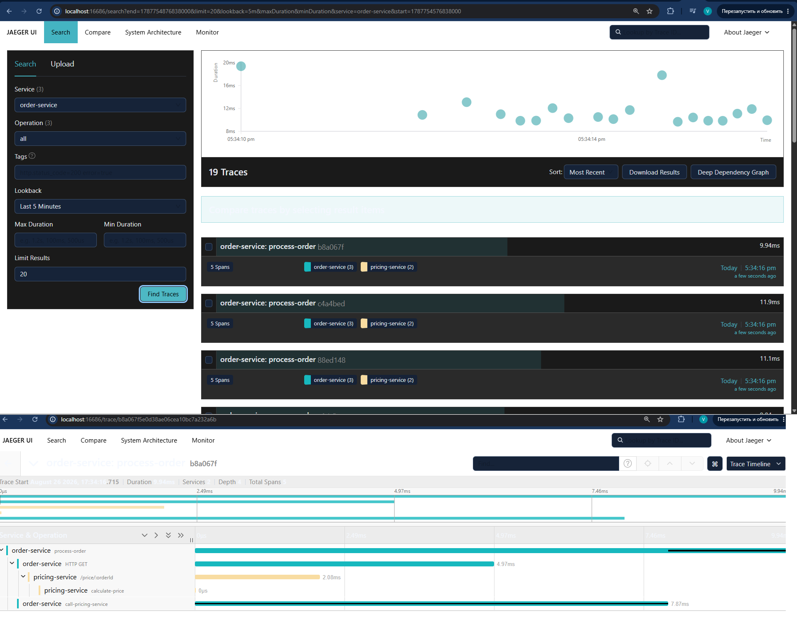

# Jaeger в Minikube с сервисами

## Описание

Развёртывание Jaeger в Minikube с двумя сервисами, которые:

1. Взаимодействуют между собой
2. Отправляют трейсы в Jaeger

> **Примечание.** В целях демонстрации MVP трейсы экспортируются непосредственно в Jaeger, минуя OpenTelemetry Collector. В производственной архитектуре, описанной в файле `Архитектурное_решение_по_трейсингу.md`, между сервисами и Jaeger предусмотрен OpenTelemetry Collector, отсутствующий в данном MVP для упрощения развёртывания. Конфигурации в директории `k8s` получены от DevOps-специалиста и скопированы без изменений в части развёртывания Jaeger. Демонстрационный доступ к Jaeger UI в рамках MVP осуществляется через `kubectl port-forward` без дополнительной аутентификации; меры защиты, описанные в разделе «Безопасность» файла `Архитектурное_решение_по_трейсингу.md` (прокси-аутентификация, сетевая изоляция, шифрование трафика по TLS), в данном MVP не реализованы и относятся к производственной конфигурации.

## Требования

- Minikube
- kubectl
- Docker

## Конфигурация развёртывания

- Namespace для Jaeger: `observability`
- Port для Jaeger Query UI: `16686`
- Port для сервисов: `8080`

## Установка

### 1. Запуск Minikube

```bash
minikube start --addons=ingress
```

Addon ingress используется для маршрутизации внешних HTTP-запросов к сервисам, развёрнутым в кластере Minikube.

### 2. Установка cert-manager

```bash
kubectl apply -f https://github.com/cert-manager/cert-manager/releases/download/v1.13.3/cert-manager.yaml
```

### 3. Развёртывание Jaeger

```bash
kubectl create namespace observability
kubectl create -f https://github.com/jaegertracing/jaeger-operator/releases/download/v1.51.0/jaeger-operator.yaml -n observability
kubectl apply -f k8s/jaeger-instance.yaml
```

### 4. Сборка и деплой сервисов

```bash
# Сборка образов
minikube image build -t pricing-service:latest services/pricing-service/
minikube image build -t order-service:latest services/order-service/

# Развёртывание
kubectl apply -f k8s/services.yaml
```

## Проверка работы

### Доступ к Jaeger UI

```bash
kubectl port-forward svc/simplest-query 16686:16686
```

Интерфейс Jaeger UI становится доступен по адресу http://localhost:16686 после выполнения переадресации порта.

### Тестирование сервисов

```bash
# Вызов order-service, который вызывает pricing-service
kubectl exec -it $(kubectl get pods -l app=order-service -o jsonpath='{.items[0].metadata.name}') -- wget -qO- http://order-service:8080
```

При выполнения запроса order-service возвращает ответ вида `{"orderId": "123", "price": 4500, "currency": "RUB"}`, что подтверждает успешное агрегирование данных, полученных от pricing-service.

При выполнения тестового запроса в Jaeger UI по имени сервиса order-service отображается трейс, содержащий два спана: входящий запрос order-service и дочерний спан вызова pricing-service, связанные общим trace id, что подтверждает передачу контекста трейсинга между сервисами.

## Технологии и API сервисов

pricing-service реализован на Go с использованием фреймворка Gin и предоставляет метод GET /price/{orderId}, возвращающий рассчитанную стоимость заказа.

order-service реализован на Go с использованием фреймворка Gin и предоставляет метод GET /orders/{orderId}, который при обработке запроса вызывает pricing-service и возвращает агрегированный ответ. Выбор языка Go для MVP обусловлен минимальными накладными расходами на инструментирование OpenTelemetry, простотой сборки контейнеров и отсутствием зависимости от JVM, что сокращает время развёртывания в демонстрационной среде.

Инструментирование OpenTelemetry добавлено через SDK: каждый сервис создаёт спан для входящего запроса и дочерний спан для исходящего вызова к другому сервису, контекст передаётся через заголовок traceparent спецификации W3C Trace Context.

## Структура проекта

- `services/pricing-service/` — исходный код pricing-service
- `services/order-service/` — исходный код order-service
- `k8s/services.yaml` — конфигурация Kubernetes для сервисов
- `k8s/jaeger-instance.yaml` — конфигурация Jaeger

## Скриншот Jaeger UI

При выполнения тестового запроса в Jaeger UI отображается трейс, содержащий два спана: входящий запрос order-service и дочерний спан вызова pricing-service. Скриншот подтверждает корректную передачу контекста трейсинга между сервисами.



_Рисунок 1 — Пример трейса в Jaeger UI: заказ проходит через order-service и pricing-service_

Примечание: для целей сдачи работы скриншот демонстрирует типичный трейс с двумя спанами, связанными общим trace id. В производственной среде трейсы будут содержать больше этапов (Shop API → RabbitMQ → CRM API → MES API).
